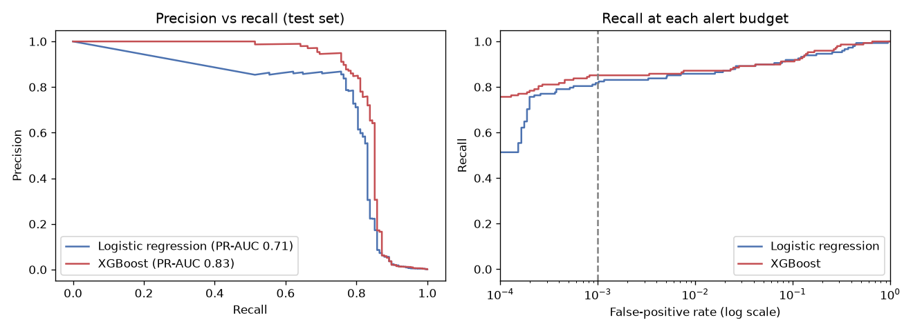
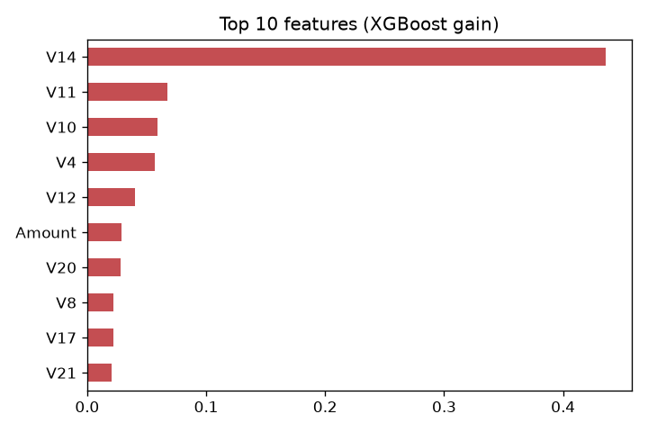

# Catching Rare Fraud in Card Transactions

**Question:** If the fraud team can only afford **1 false alarm per 1,000 good transactions**, how much fraud can a model catch?

**Data:** 284,807 real card transactions from European cardholders (ULB Machine Learning Group, via [OpenML #1597](https://www.openml.org/d/1597)). Only **492 are fraud (0.17%)**.

## Result (on a locked test set the models never saw)

| Model | Fraud caught at 0.1% false-positive rate | PR-AUC |
|---|---|---|
| Logistic regression (baseline) | 82% | 0.71 |
| **XGBoost** | **85%** (126 of 148) | **0.83** |

XGBoost stopped **€12.9K of €19.3K** fraud in the test set (67% by value).



## Approach
1. **Why not accuracy?** "Always say not fraud" is 99.83% accurate and catches nothing. Instead, measure **recall at a fixed false-positive rate** (the review team's alert budget).
2. **Honest split:** 70/30 train/test, with a validation slice of the training data used only to **choose the alert threshold**. The test set is touched once.
3. **Models:** an explainable logistic-regression baseline, then XGBoost, with both weighted for the 1-in-580 class imbalance.
4. **Business dial:** the recall-vs-FPR curve shows how much more fraud a bigger review team could catch.



## Limitations
- Two days of data from one issuer. Features `V1`–`V28` are anonymized, so the drivers can't be explained in business terms.
- The OpenML copy has no timestamp, so the split is random rather than time-based. In production I'd validate on later periods and monitor for drift.

## Run it
```bash
pip install pandas scikit-learn xgboost matplotlib pyarrow nbconvert ipykernel
python -c "from sklearn.datasets import fetch_openml; fetch_openml(data_id=1597, as_frame=True, parser='pandas').frame.to_parquet('data/creditcard.parquet')"
python build_notebook.py && jupyter nbconvert --to notebook --execute --inplace notebooks/fraud_detection.ipynb
```

*Sanika Satoskar · 2026*
